# 拾物 × 客服咪 · 电商社交与 AI 助手

浏览商品、和好友讨论、建立购物群，让侧边的客服咪帮你做商品对比、整理观点和待办。基于原电商知识图谱项目扩展，新增完整的平台交互与本地持久化。

## 立即运行

```powershell
python -m pip install -r requirements.txt
python run.py
```

打开 **http://127.0.0.1:8000**。建议 Python 3.11+。首次启动自动初始化演示数据，不需要下载模型或先启动数据库。

本机可以直接执行 `D:\zhinengdianshang\graph2\python.exe run.py`。

## 已实现

- 商城：商品搜索、品牌/类别筛选、详情、来源展示和商品分享。
- 社交：5 个演示身份、双向好友申请、实时私聊、建群、成员管理、未读和历史消息。
- 客服咪侧栏：多轮商品筛选、2–4 件商品对比、聊天总结、原消息定位、结果预览与分享。
- 本地工具可直接运行；可选 DeepSeek 问答与带引用校验的模型摘要。
- 12 件种子商品；支持从原 MySQL 只读导入快照。本机已导入 43 个 SKU，共 55 件商品。
- SQLite WAL、消息幂等、用户与群组权限检查、WebSocket 重连补拉。
- 可选 Neo4j 固定参数化只读图谱查询；原离线 NER 与同步代码保留。

**用途为本地演示和评审**：预置身份切换不是生产账号认证，价格和参数是快照，商品插画为示意图。默认 AI 模式为本地检索与摘录，界面如实标注；模型密钥和独立图谱只读账号需自行配置。没有真实支付或微信采集。

## 演示与验收

在两个标签页分别选择林一、周可，进入“周末好物研究所”：讨论商品 → 侧栏生成对比 → 总结聊天 → 定位原话 → 预览后将 AI 结果发回群内。

```powershell
python -m unittest discover -s tests -v
node --check src/web/static/platform.js
```

运行数据保存在 `data/runtime/platform.db`，普通重启不覆盖。`.env` 与运行数据不进入源码交付。

- [运行、模型配置与完整演示脚本](docs/运行与演示.md)
- [架构、数据与接口](docs/架构与接口.md)
- [验收报告与验证范围](docs/验收报告.md)

## 页面预览

商城与侧边客服咪：

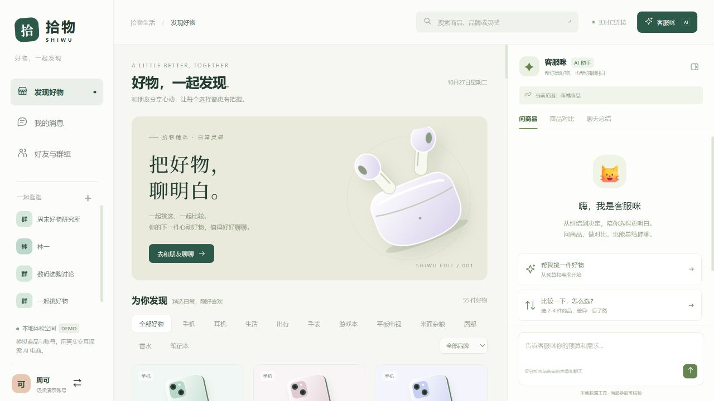

群聊、商品对比与信息总结：

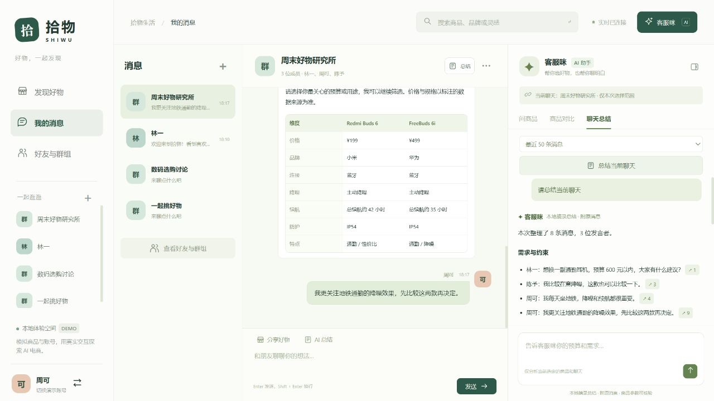

## 原项目技术记录（v1）

以下保留原有图谱与训练说明。新平台入口以本文上方与运行文档为准；v1 页面截图和交互描述不代表 v2 当前界面。BERT 用于离线商品标签抽取，在线平台功能与其分别验证。

# ⚡ 客服咪 · 电商智能知识图谱助手 (Smart E-Commerce Graph-RAG)

> 基于 **DeepSeek 大语言模型 + BERT 命名实体识别 + Neo4j 知识图谱** 的新一代智能电商导购问答系统。

---

## 🌟 核心特性
1. **NER 实体识别**：基于 `google-bert/bert-base-chinese` 微调的 Token Classification 实体抽取模型，精准抽离品牌、商品及核心参数。
<p align="center">
  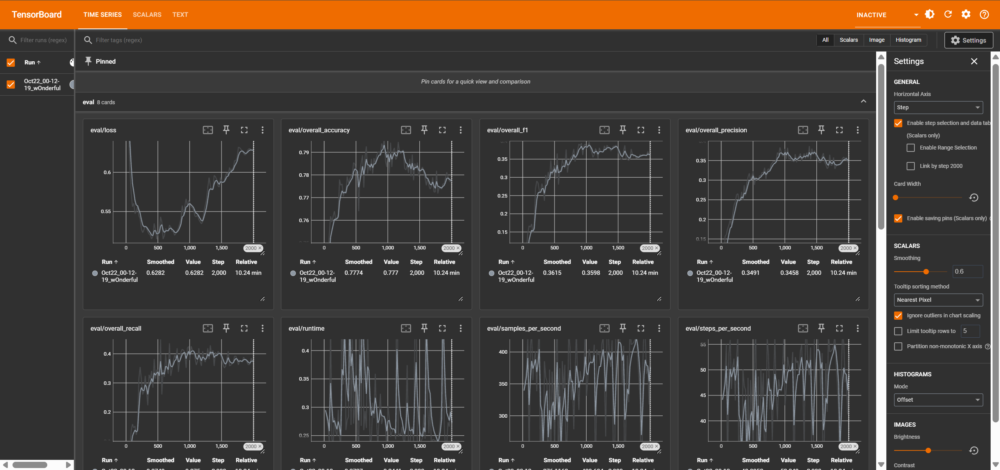
</p>
<p align="center">
  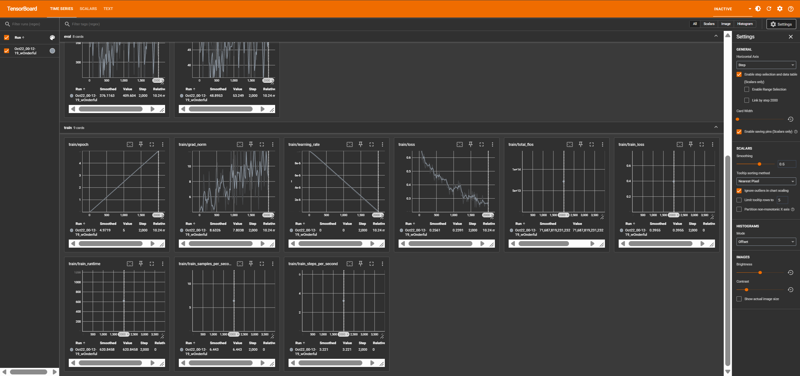
</p>
2. **知识图谱同步**：自动将关系型业务数据库（MySQL）同步对齐至 Neo4j 图数据库，构建实体关系网络。

<p align="center">
  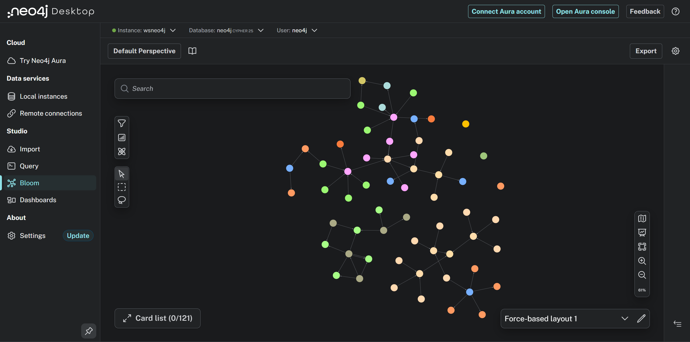
</p>
<p align="center">
  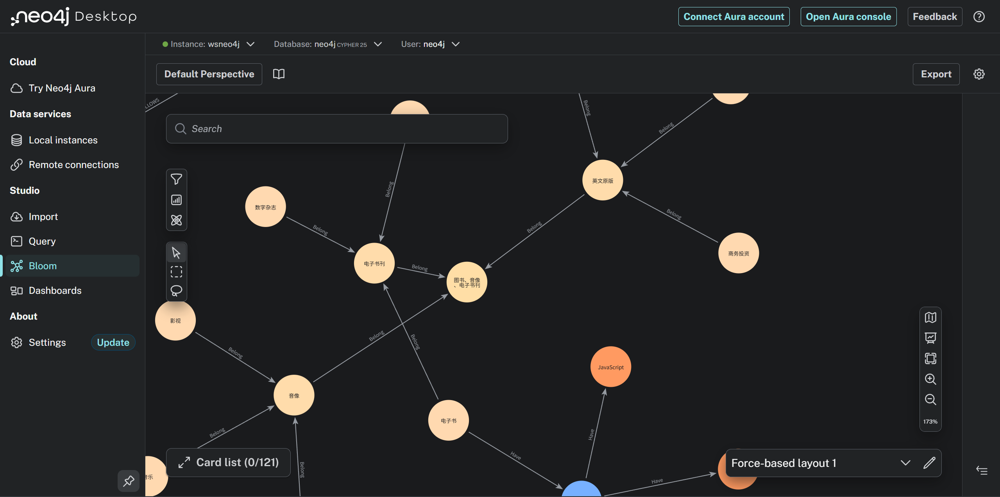
</p>

3. **GraphRAG 检索增强**：结合向量语义召回与 Cypher 图查询，大模型根据多跳图谱三元组进行精准结构化回答。
4. **液态玻璃前端**：
   - 晶莹纯白磨砂玻璃视觉 (`backdrop-filter: blur(32px)`)；
   - 动态交互背景画布（粒子斥力连线 + 鼠标点击冲击波涟漪）；
   - 自由活动的桌面宠物猫（支持平滑地面漫游、拉伸/压扁/融化抽象变形、连续戳猫触发「生气头变大」爆笑暴怒模式）。

<p align="center">
  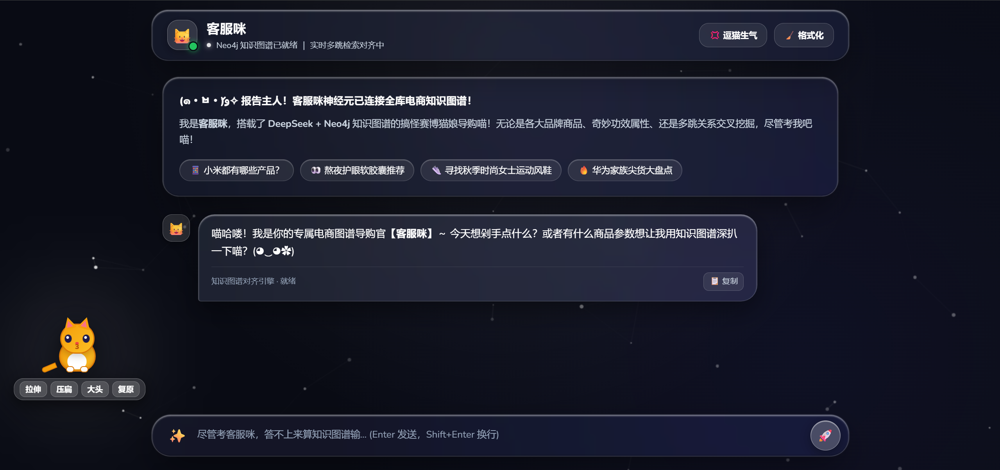
</p>
<p align="center">
  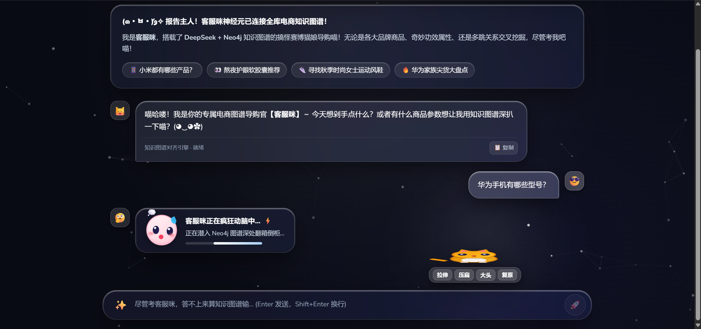
</p>
<p align="center">
  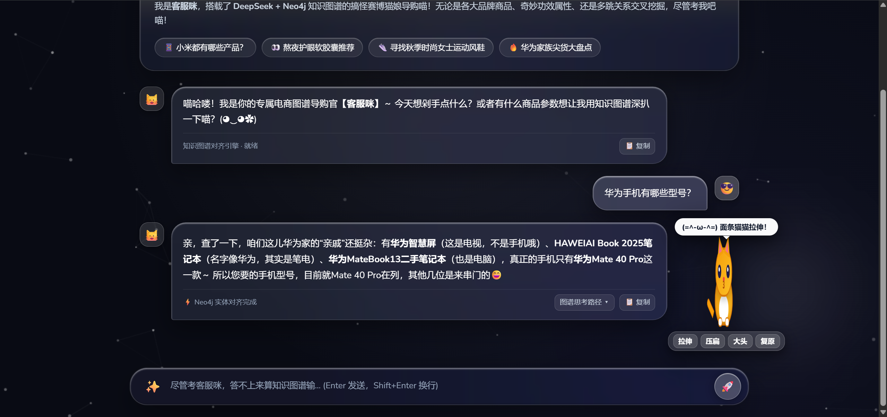
</p>
<p align="center">
  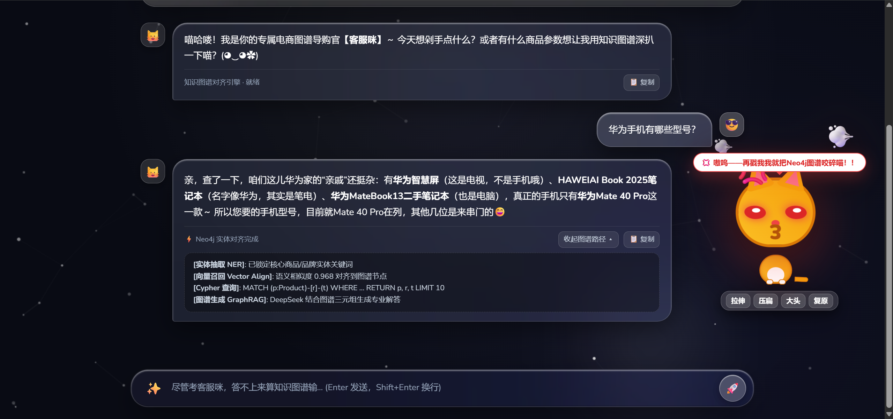
</p>
<p align="center">
  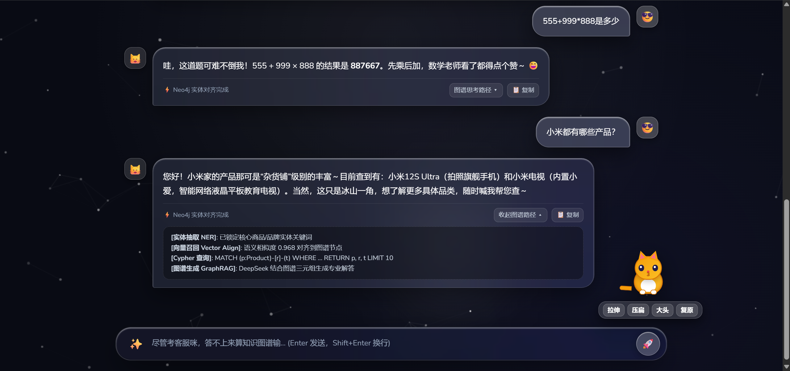
</p>
<p align="center">
  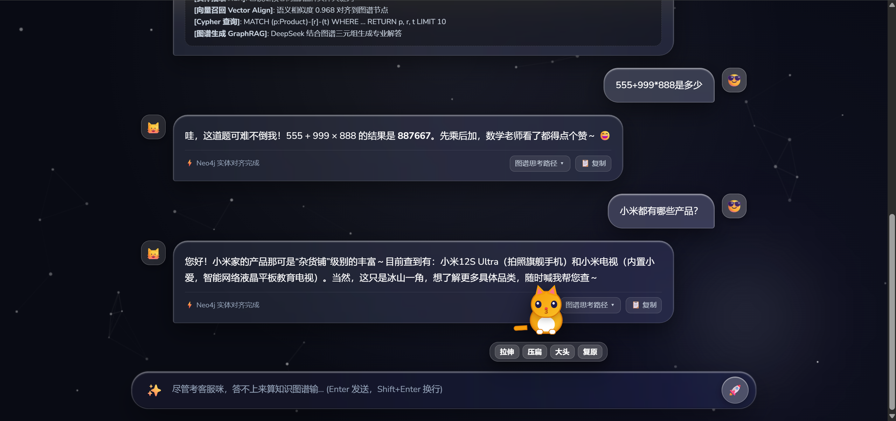
</p>

---

## 📂 项目结构
```
er_graph/
├── assets/                  # 项目演示图片与图谱截图
├── data/                    # NER 标注数据与清洗处理集
│   └── ner/
├── src/
│   ├── configuration/       # 全局配置中心 (MySQL, Neo4j, API Keys)
│   ├── datasync/            # MySQL 到 Neo4j 图谱数据同步管道
│   ├── ner/                 # BERT Token Classification 预处理、训练与推理
│   └── web/                 # FastAPI Web 服务、GraphRAG 对话逻辑与液态玻璃前端
└── .gitignore
```

---

## 🚀 快速启动

### 1. 启动 Web 对话服务
```bash
python src/web/app.py
```
服务启动后，在浏览器访问：
👉 `http://127.0.0.1:8000/static/index.html`
