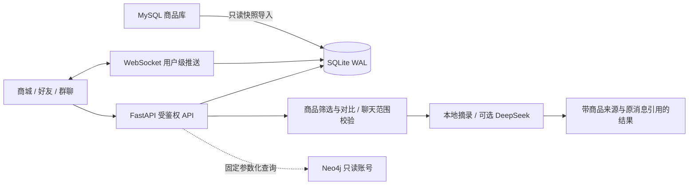

# 架构与接口

## 运行链路

## 模块

| 文件 | 作用 |
| --- | --- |
| run.py、src/web/app.py | 环境读取、应用工厂、请求 ID、健康检查与静态页面 |
| src/web/store.py | SQLite 表、事务、种子数据与序列化 |
| src/web/platform_api.py | 演示会话、好友、群组、消息、商品与用户级 WebSocket |
| src/web/assistant_api.py | 权限和范围校验、连续条件检索、对比、摘要与模型调用 |
| src/web/graph_tools.py | 固定参数的只读 SKU 邻接查询 |
| src/web/static/platform.js、platform.css | 自适应商城、即时通信与助手侧栏 |
| scripts/import_mysql_catalog.py | 原业务库只读快照导入 |

浏览器发送 `Authorization: Bearer {演示会话token}`；token 存在 sessionStorage，每个标签页独立。WebSocket 建连后第一条消息为 `{"token":"..."}`，不把凭证放在 URL。服务端基于 token 查询身份，不接受客户端提供的消息作者身份。

## 主要接口

| 方法 | 地址 | 用途 |
| --- | --- | --- |
| GET | /api/health | SQLite 健康状态；不伪称已校验外部服务 |
| GET、POST | /api/demo-users、/api/session | 列举演示账号、选择当前身份 |
| GET | /api/bootstrap | 当前用户、好友、申请、会话、成员与未读 |
| GET | /api/users?q= | 搜索演示用户 |
| POST | /api/friends/requests | 发起申请，user_id |
| POST | /api/friends/requests/{id}/accept 或 reject | 由接收方处理申请 |
| POST | /api/conversations/direct | 与已成为好友的用户开启单聊 |
| POST | /api/groups | name、member_ids，创建群聊 |
| PATCH | /api/groups/{id} | 群主修改群名 |
| POST | /api/groups/{id}/members | 群主邀请自己的好友，user_ids |
| DELETE | /api/groups/{id}/members/{user_id} | 群主移除成员或成员自行退出 |
| GET | /api/conversations/{id}/messages | before 分页、around 原消息定位、limit 最大 100 |
| POST | /api/conversations/{id}/messages | 文字、商品或已保存 AI 结果；client_id 去重 |
| POST | /api/conversations/{id}/read | 更新当前用户已读游标 |
| GET | /api/products | q、category、brand 筛选 |
| GET | /api/products/{id} | 商品详情与来源 |
| GET | /api/products/{id}/graph | 可选原 SKU 图谱依据 |
| GET | /api/assistant/history | 当前用户及指定 conversation_id 的 AI 历史 |
| POST | /api/assistant/ask | action 为 chat/compare/summary；product_ids、conversation_id、scope |
| WS | /ws | 首条 token 验证后接收 message/refresh/membership 等事件 |

交互式接口文档位于 `/docs`。摘要 `scope` 支持 recent/all/range，range 要求含时区的 ISO 时间。摘要最多 1000 条；模型总结最多 200 条。商品对比需要 2–4 个有效、去重后的商品 ID，也可从当前聊天的商品消息中选择。

## 关键实现约束

- 好友申请以排序后的两人组合约束待处理记录，避免双向重复申请。
- 单聊以两人组合唯一化；群组单独存储成员和群主。
- 消息的 `(user_id, client_id)` 唯一。同一标识在不同会话或对应不同内容时拒绝复用。
- WebSocket 推送给服务端查询到的当前成员；不接受客户端任意订阅其他会话。
- AI 读取聊天前、模型调用后写入前分别检查成员身份。
- 商品表、摘要引用和对比表使用结构化数据；UI 对外部文字转义后显示，不将聊天内容作为 HTML 执行。
- 摘要保存覆盖的最后消息 ID 和截止时间；新消息到来时提示摘要需要更新。
- 消息分页、重连后补拉和历史恢复均经 API 权限校验。
